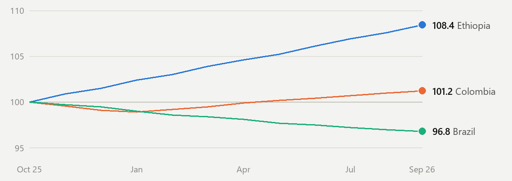

# Emails that move

The Outlook Email Kit. Animated charts, vector graphics and scenes that breathe, all inside the Outlook inbox, the
strictest canvas in office software. There is no JavaScript in the emails.

**See it working:** https://pavolkum.github.io/emails-that-move/ (both emails in a simulated Outlook window, plus a replay of how the kit was built)



## What you get

- **Charts that draw themselves.** Animated GIF charts whose first frame is the finished chart, so an Outlook that
  won't animate still shows the numbers. Each one plays three times, matching the Microsoft 365 cap.
- **Vector graphics in classic Outlook.** Classic Outlook renders HTML with Word and ignores most CSS, but it still
  draws VML, so donuts and line charts stay sharp there.
- **Scenes that breathe.** A looping GIF built so the last frame flows into the first (see the night tower in
  `examples/lights_out.py`).
- **A preview lab with the real thing in it.** Three panes: classic Outlook rendered by Word itself (through COM),
  new Outlook simulated in Chromium, and the Adaptive Card. No testing subscription.
- **Python building blocks:** donuts, line and bar charts, heatmaps, sparklines, KPI tiles, buttons, a masthead,
  Adaptive Card helpers, and themes.


## Where each piece works

| Outlook | Engine | Gets |
|---|---|---|
| Classic Outlook (Windows desktop) | Word's HTML import | Tables, VML vectors, GIFs. Microsoft 365 animates them; Outlook 2013-2019 shows frame 1 |
| New Outlook, Outlook on the web, mobile, Mac | Chromium/WebKit behind Microsoft's sanitizer | Modern CSS mostly, images, GIFs |
| Actionable Message (work accounts with Actionable Messages on) | Adaptive Card JSON in the email head | Tabs, drill-downs, inputs, HTTP actions |

One email carries all three: `<!--[if mso]>` for classic Outlook, `<!--[if !mso]><!-->` for everyone else, and the
card on top where it is supported.

## Quick start

```bash
python -m pip install pillow
python examples/roast.py --theme flat --out work/emails      # a weekly KPI email: copy this file for your own

# Windows with Word: render the classic Outlook view and open the three-pane lab
python -m pip install pywin32 pymupdf
python scripts/build_lab.py work/emails                      # writes work/lab.html

# optional: a headless check of every pane
python -m pip install playwright && python -m playwright install chromium
python scripts/verify_lab.py work/lab.html

# send it to yourself through classic Outlook (dry run without --send)
python scripts/send_outlook.py work/emails/roast.html --send
```

Python 3.10 or newer. The lab works offline.

## Use it from Claude Code

The repo is a Claude Code skill. Clone it into your skills folder and ask for an email:

```bash
git clone https://github.com/PavolKum/emails-that-move ~/.claude/skills/outlook-email
```

`SKILL.md` tells Claude how the kit works: which renderer gets what, the rules that bit us, and the workflow.

## Examples

| File | What |
|---|---|
| `examples/roast.py` | **Roast Report**, the weekly email of a fictional coffee roastery: donuts, an index line chart, a heatmap, a watchlist and an Adaptive Card. The scaffold for your own emails |
| `examples/gif_gallery.py` | A GIF test email. Send it to yourself to find out what your Outlook does with animated charts |
| `examples/lights_out.py` | The night tower as an ambient loop, plus an experimental Lights Out puzzle as an Adaptive Card (see the limits below) |
| `examples/probe.html` | A capability probe: which technique renders where |

## Limits, plainly

- Outlook 2013-2019 shows only a GIF's first frame. Animation can also be switched off in Outlook, in Windows, or by
  a VDI session. That is why every chart's first frame is the finished chart.
- Outlook for Microsoft 365 desktop plays a GIF up to three times, then shows a Play button.
- The classic render needs Windows with Word installed. The new-Outlook pane is a simulation of Microsoft's sanitizer
  and only approximates it.
- The Adaptive Card layer renders in Outlook with a work account where Actionable Messages are switched on. A card
  sent to yourself needs no registration; sending it to others needs a registered provider. Everywhere else the
  HTML email shows instead, so the card is a bonus, never the only content.

## How it was built

The kit came out of one Claude Code conversation on a Saturday: 11 prompts, all spoken in voice mode. The coffee
roastery demo, the ambient loop and the landing page followed the next morning. The landing page in `docs/` shows
both emails in a simulated Outlook window and replays those 11 prompts, one by one.

## License

MIT, see `LICENSE`. Bundled in `assets/vendor/`: the Adaptive Cards JavaScript renderer and markdown-it, both MIT
(see `THIRD_PARTY_NOTICES.md`). All data in the examples is fictional.
